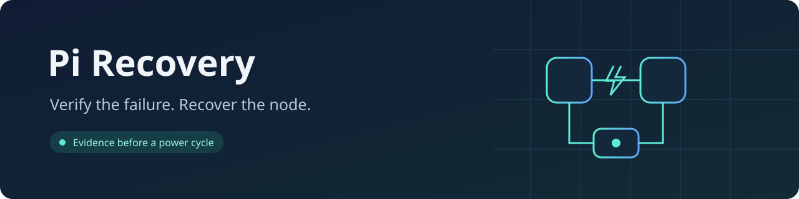
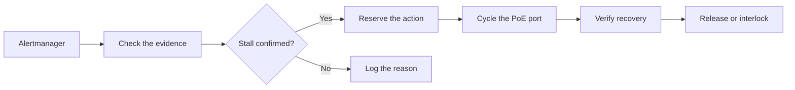

<p align="center">
  
</p>

<p align="center">
  <a href="https://github.com/abhi1693/pi-recovery/actions/workflows/ci.yml"></a>
  
  
  
  
</p>

<p align="center">
  A small Alertmanager receiver that checks a suspected network stall before<br>
  requesting a switch-side PoE power cycle.
</p>

---

## Recovery with evidence

A node going offline is a reason to investigate. Pi Recovery checks the node,
its peers, recent metrics, and the switch port before deciding whether a power
cycle is appropriate. The current adapter supports UniFi-managed PoE switches.

| Observe | Confirm | Recover |
| :--- | :--- | :--- |
| Receive an authenticated alert and recheck its live state. | Correlate node health, port identity, power, and directional traffic. | Reserve one action, cycle the approved port, and verify the new boot. |



## What it checks

- **The outage:** the node is unreachable, its exporter has failed for at least
  two minutes, and independent management probes receive no reply.
- **The rest of the cluster:** the configured inventory matches, healthy peers
  remain reachable, control-plane quorum is intact, and the observer is on another node.
- **The conditions before failure:** CPU, memory, load, I/O pressure, boot age,
  maintenance state, and the reviewed kernel.
- **The switch:** the pinned controller certificate, reviewed application
  version, switch identity, port mapping, link state, and PoE health.
- **The traffic pattern:** traffic from the node remains frozen while traffic
  toward it advances across fresh, independent switch samples.

When a silent NIC's learned MAC entry ages out, the approved static node-to-port
mapping can be used. Conflicting MAC evidence, multiple devices, link errors,
unhealthy power, or failed checks still block the action.

> [!NOTE]
> An external observer cannot prove that an unreachable node's operating system
> is alive. Pi Recovery looks for a strong matching pattern; it does not claim a
> definitive diagnosis of the hardware or driver fault.

## One recovery at a time

Replicas coordinate through a Kubernetes Lease. Leadership belongs to a recovery
attempt rather than to a permanent primary.

| Control | Behavior |
| :--- | :--- |
| Concurrency | One recovery across the cluster. |
| Priority | Unavailable control-plane nodes are recovered before workers. |
| Cooldown | Five minutes between reservations by default; configurable with `cooldown_seconds`. |
| Daily quotas | No per-node or cluster-wide daily cap. |
| Active recovery | Another cycle is blocked while an action is reserved or being verified. |
| Uncertain result | Failed or ambiguous actions require review before automation resumes. |
| Repeat delivery | A persisted reservation prevents a repeated alert from issuing another cycle. |

The action is recorded **before** the non-idempotent switch request. Ambiguous
power requests are never retried automatically. Recovery is confirmed by a new
boot ID, the same Kubernetes node identity, Ready status, and a successful scrape.
Two unavailable nodes can be handled by default. Both alert scheduling and the
final pre-cycle check enforce control-plane priority, so alert arrival order
cannot let a worker bypass an unavailable control-plane node. Recent action
history is bounded for storage; it does not impose a daily recovery quota.

## Run it

Pi Recovery runs in Kubernetes with a restricted service account. It needs read
access to nodes and get/update access to its pre-created Lease. The runtime uses
the Python standard library and runs as an unprivileged user.

Configuration is loaded from `/etc/pi-recovery/config.json`, or the path set in
`PI_RECOVERY_CONFIG`. Start with `enabled: false` to observe decisions before
allowing automatic recovery.

| Configuration | Purpose |
| :--- | :--- |
| `nodes` | Reviewed node addresses, physical NIC MACs, and switch port numbers. |
| `unifi_origin`, `unifi_api_key` | Controller connection and authentication. |
| `unifi_certificate_sha256`, `unifi_application_version` | Controller identity and schema pins. |
| `site_id`, `switch_id`, `switch_legacy_id`, `switch_mac` | Explicit switch bindings. |
| `prometheus_origin`, `node_exporter_port` | Metrics endpoint and node-exporter discovery. |
| `approved_kernel` | Kernel release permitted by the recovery policy. |
| `webhook_token` | Bearer token required on `/webhook`. |
| `sample_interval_seconds` | At least 30 seconds between observations. |
| `cooldown_seconds` | Positive seconds between reservations; default `300`. |
| `max_unavailable_nodes` | Maximum concurrent unavailable nodes to assess; default `2` for clusters with at least three nodes. |
| `lease_namespace`, `lease_name` | Durable coordination resource. |

`POD_NAMESPACE`, `POD_UID`, and `NODE_NAME` can be populated through Kubernetes'
downward API. An operator can override the state annotation and maintenance key
with `PI_RECOVERY_STATE_KEY` and `PI_RECOVERY_MAINTENANCE_KEY`.

> [!IMPORTANT]
> Preserve the Lease's runtime state across deployments. Keep recovery history
> and active reservations out of ordinary declarative resets. Deleting the Lease
> can erase the coordination evidence that prevents repeated power cycles.

## See what is happening

Logs are structured JSON. During an incident, the sequence is easy to follow:

```text
lease_requested → lease_acquired → observed → confirmed
                                      ↓
                         reserved → cycled → recovered → lease_released
```

Each entry identifies the observing node and pod. Passing observations include
directional packet counters; recovery verification emits progress at most once
per minute. Refused actions include a stable reason. Routine health checks and
scrapes stay quiet, and credentials and response bodies are not logged.

| Endpoint | Purpose |
| :--- | :--- |
| `POST /webhook` | Authenticated Alertmanager receiver. |
| `GET /healthz` | Process health. |
| `GET /readyz` | Receiver readiness. |
| `GET /metrics` | Event counters, automatic mode, ledger health, and review state. |

Receiver readiness means the app can accept requests. Dependency checks run for
each candidate before a power action is considered.

## Develop

```sh
python3 -m unittest discover -s tests -v
docker build -t pi-recovery:dev .
bash scripts/ci/smoke.sh pi-recovery:dev linux/amd64
```

Tests cover matching stalls, stale and incomplete evidence, conflicting ports,
concurrent replicas, cooldowns, in-progress recovery, ambiguous failures, and
authenticated HTTP handling. Power operations in tests use fakes.

CI reuses the Python and container workflows from
[`abhi1693/actions`](https://github.com/abhi1693/actions). Images are built on
native ARM64 and AMD64 runners, checked with a runtime smoke test, scanned, and
published with SBOMs, provenance, and digest attestations.
